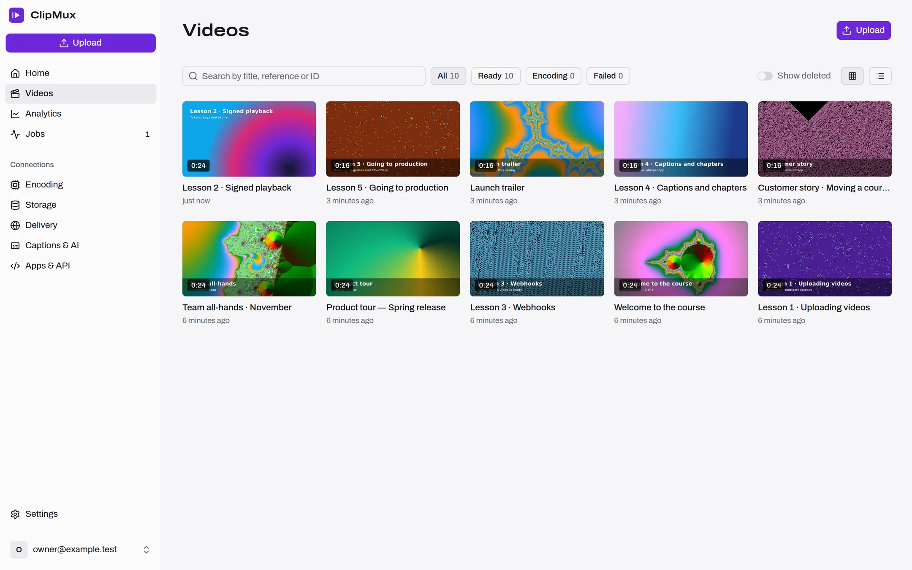
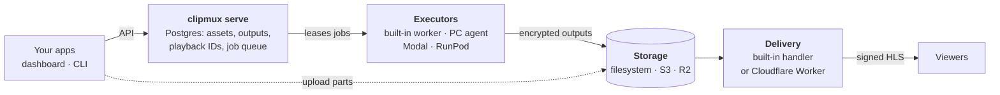
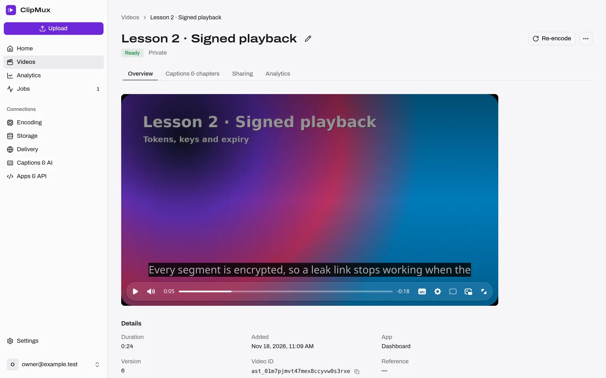
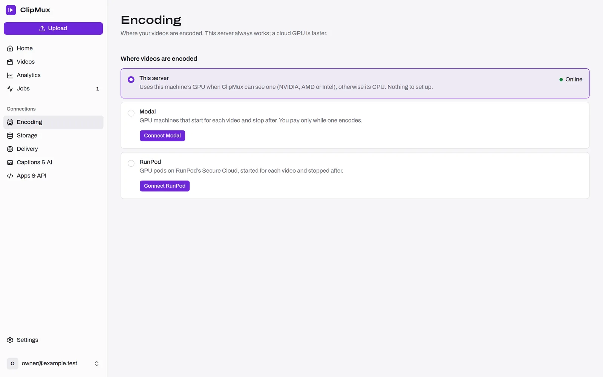
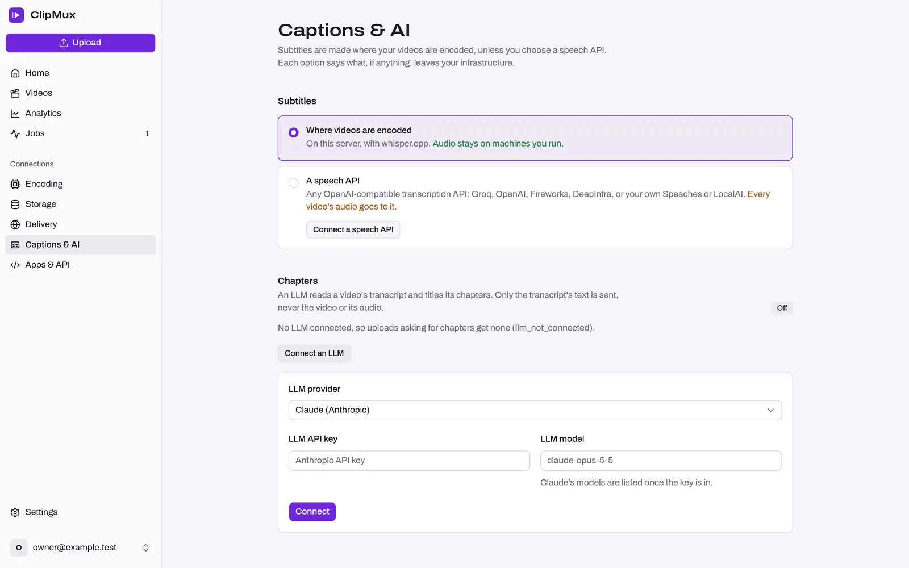
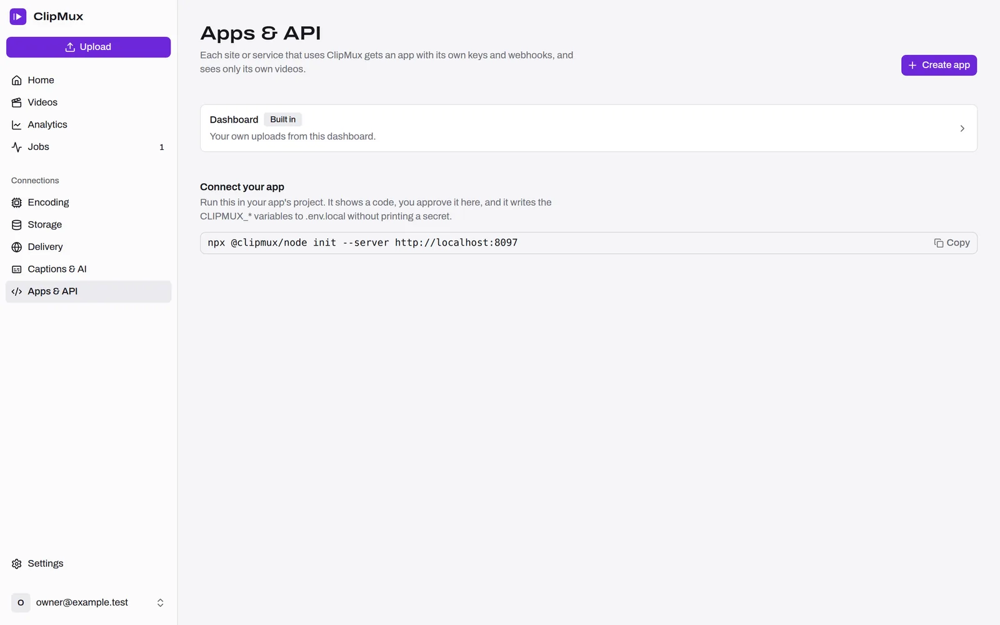

<div align="center">


# ClipMux

**Self-hosted video infrastructure.**<br>
Upload, encode and stream encrypted HLS from servers you own.<br>
An open-source alternative to Mux and Cloudflare Stream.

[](LICENSE)
[](https://github.com/visheshgubrani/clipmux/releases)
[](go.mod)
[](https://www.npmjs.com/package/@clipmux/node)
[](https://github.com/visheshgubrani/clipmux/actions/workflows/ci.yml)

[Website](https://clipmux.com) ·
[Docs](https://clipmux.com/docs) ·
[Quick start](#quick-start) ·
[Integrate](#integrate-in-four-steps) ·
[How it works](#how-it-works) ·
[Contributing](CONTRIBUTING.md)

</div>

<br>

<picture>
  <source media="(prefers-color-scheme: dark)" srcset="docs/assets/screenshots/videos-dark.webp">
  
</picture>

<br>

Any app uploads a video, gets a playback ID, and streams it to every device
as encrypted HLS: from your own storage, encoded on your own GPU (or one you
rent by the minute), behind playback tokens your backend signs. ClipMux is one
Go binary and Postgres. Storage, encoding and delivery each sit behind an
adapter, so you can move from a disk to R2, or from your server to a cloud
GPU, and the API your apps call doesn't change.

Use it wherever an app needs video on demand: course libraries, user
uploads, private videos for paying customers. ClipMux serves the course videos of [Edural](https://edural.com) in production.

## Features

- **Uploads that resume.** Browsers send S3 multipart parts straight to
  storage, so a dropped connection picks up where it stopped, for files up to
  hundreds of gigabytes. Import from a URL, or push from the command line with
  `clipmux push`.
- **Encode anywhere.** The built-in worker uses NVENC or VAAPI when it finds a
  GPU. Or send encodes to [Modal](https://clipmux.com/docs/self-host/encoding/modal) or
  [RunPod](https://clipmux.com/docs/self-host/encoding/runpod) GPUs with a monthly spend limit, or to a
  [PC at home](https://clipmux.com/docs/self-host/encoding/your-pc). Executors never hold storage credentials.
- **A ladder up to 4K.** Every standard rendition up to the source's own size,
  or only the ones an upload asks for.
- **Encrypted by default.** Every output is AES-128 fMP4 HLS, segmented and
  encrypted by Shaka Packager. Keys are derived at delivery and never stored,
  so stored files, cached copies and leaked segment URLs are ciphertext.
- **Signed playback.** Your backend signs short-lived ES256 tokens locally,
  with no call to ClipMux. Playback IDs are public or signed, many per video,
  and revocable; poster tokens can't play the video.
- **Origin or edge delivery.** Serve playback from ClipMux itself, or connect
  Cloudflare in one dialog: the [ClipMux Worker](https://clipmux.com/docs/self-host/delivery/cloudflare) serves
  from R2 at the edge, and videos keep playing while your server is down.
- **Subtitles and chapters.** Transcribe with whisper.cpp on your own GPU
  (CUDA or Vulkan) or CPU, or with any OpenAI-compatible speech API. Chapters
  are titled by Claude or any OpenAI-compatible model, Ollama included.
- **Share links and analytics.** Expiring share pages, and views, watch time,
  bandwidth and unique viewers, counted at delivery and kept in Postgres. No
  second database.
- **Built for integrations.** One App per integration, each with its own
  scoped API keys, signing keys, HMAC-signed webhooks and videos. A
  `passthrough` field ties each video to your record. The API is described by
  an OpenAPI spec served at `/openapi.json`.
- **Hardened.** ffmpeg runs under Landlock and seccomp, routes are
  default-deny, worker file names are untrusted, and the owner signs in with
  two-factor codes.
- **A dashboard you'll actually use**, light and dark, on a laptop or a phone.

## Coming from Mux or Cloudflare Stream?

ClipMux has the same shape. A video gets one or more playback IDs, public or
signed. Your backend signs a JWT for private playback without calling the
service. Browsers upload straight to storage, a `passthrough` field ties each
video to your record, and HMAC-signed webhooks say when a video is ready,
with the same event names as Mux. The difference is that you run it, on your
storage and your GPUs, and you can still serve playback from Cloudflare's
edge through a Worker and an R2 bucket in your own account.

It doesn't do live streaming, DRM (videos are AES-128 encrypted HLS), MP4
downloads, thumbnails at a chosen time, GIFs, storyboards or an iframe embed.
The [Migrate from Mux](https://clipmux.com/docs/resources/migrate-from-mux) and
[Migrate from Cloudflare Stream](https://clipmux.com/docs/resources/migrate-from-cloudflare-stream)
guides map each concept and move an app across without downtime; the
[FAQ](https://clipmux.com/docs/resources/faq) covers what it costs to run.

## Quick start

You need a Linux server (amd64 or arm64) with Docker and Compose v2, ports 80
and 443 free, and two DNS names pointing at it: one for the dashboard and API,
one for media.

```bash
curl -fsSL https://clipmux.com/install.sh | sudo sh
```

The installer puts ClipMux, Postgres and Caddy in `/opt/clipmux`, generates
the database password and the secrets key, starts the stack and prints:

```text
  ClipMux v1.0.0 is running.

  Open:         http://203.0.113.10
  Setup token:  N4V3…

  Secrets key:  v1:…
  Store this off the host, with your database backups.
```

1. Open the address and create the owner account with the setup token.
2. Set the public URL and the media URL. Caddy gets a certificate for each
   hostname on its first visit.
3. Run the setup test from **Settings**: a sample video goes through upload,
   encode, encryption and playback, and each check is shown.
4. Turn on two-factor sign-in, and upload your first video.

Run the same command again to upgrade in place; the data, keys and sessions
are kept. `sh -s -- --version vX.Y.Z` installs a given release, and
`--uninstall` stops it while keeping the volumes (add `--purge` to delete
them).

<details>
<summary><b>Install from source with Compose</b></summary>

```bash
git clone https://github.com/visheshgubrani/clipmux && cd clipmux
cp deploy/compose.env.example deploy/.env      # set POSTGRES_PASSWORD and CLIPMUX_SECRETS_KEY
docker compose -f deploy/compose.yml up -d --build --wait
docker compose -f deploy/compose.yml logs app | grep setup_token
```

</details>

<details>
<summary><b>Behind your own reverse proxy</b></summary>

On a host where another proxy already owns ports 80 and 443, add
`deploy/compose.proxy.yml`, which leaves Caddy out and listens on
`127.0.0.1:8080`. On a small or shared host, set
`CLIPMUX_BUILTIN_WORKER=false` and encode on Modal or RunPod instead. See
[Behind your own reverse proxy](https://clipmux.com/docs/self-host/install-options/reverse-proxy).

</details>

Backups, upgrades, metrics and every setting are in the
[Self-host docs](https://clipmux.com/docs/self-host) and the
[environment variables](https://clipmux.com/docs/reference/configuration).

## Integrate in four steps

With the Node SDK, an app goes from nothing to signed, encrypted playback in
four steps. The full walkthrough is in
[packages/node](packages/node/README.md).

**1. Connect the app.** The owner approves it in the dashboard, and the
credentials land in `.env.local` without being printed.

```bash
npm i @clipmux/node @clipmux/uploader @clipmux/player
npx @clipmux/node init --server https://video.example.com
```

**2. Add one route file**, here `app/api/clipmux/[action]/route.ts` in Next.js:

```ts
import { clipmuxHandler } from '@clipmux/node/handlers'

export const POST = clipmuxHandler({
  // Who may upload, and what the upload is. Return null to refuse.
  async upload(req, { file }) {
    const user = await requireInstructor(req)
    return { passthrough: `lesson_${lessonId(req)}`, title: file.name, generate: { subtitles: true } }
  },
  // Who may watch. Return null to refuse.
  async playback(req, { playbackId }) {
    const user = await getUser(req)
    return (await canWatch(user, playbackId)) ? { viewerId: user.id } : null
  },
  // A verified webhook, with the asset re-fetched so it is current.
  async asset(asset) {
    await db.lesson.update({ where: { ref: asset.passthrough }, data: { status: asset.status } })
  },
})
```

**3. Add two elements** to your pages. The browser never sees an API key or
a signing key.

```html
<clipmux-uploader create-url="/api/clipmux/upload?lesson=42"></clipmux-uploader>
<clipmux-player playback-id="pid_…" session-url="/api/clipmux/playback"></clipmux-player>
```

**4. Check it**, and forward webhooks to your laptop while you build:

```bash
npx @clipmux/node doctor
npx @clipmux/node listen --forward-to localhost:3000/api/clipmux/webhook
```

The handler is a plain Fetch handler, so it also runs in Express, Hono,
SvelteKit, Remix, Bun, Deno and Cloudflare Workers. From any other language,
call the [REST API](https://clipmux.com/docs/reference/api) (its OpenAPI spec is at `/openapi.json` on
your instance) and sign playback tokens as standard ES256 JWTs.
The [Build docs](https://clipmux.com/docs/build) are the path through it, starting with the
[quickstart](https://clipmux.com/docs/build/quickstart).

## How it works



- **Ingest, compute and delivery share data, not calls.** Each reads and
  writes the data model in Postgres; side effects outside it run from outbox
  rows, and a reconciler repairs any drift.
- **Executors stay dumb.** A worker leases a job, gets a short-lived attempt
  token and URLs signed for that job alone, runs ffmpeg and Shaka Packager in
  a sandbox, and commits. It never sees a storage credential or a content key.
- **Outputs are immutable.** A re-encode writes a new output and then moves a
  pointer, and only one job that changes a video runs at a time.
- **Playback doesn't need the control plane.** In Worker mode, route records
  in R2 let the edge authorize and serve videos on its own.

The full design, with its threat model, is in
[docs/architecture.md](docs/architecture.md); every decision since is in
[docs/decisions.md](docs/decisions.md).

## Screenshots

<table>
<tr>
<td width="50%">
<picture>
  <source media="(prefers-color-scheme: dark)" srcset="docs/assets/screenshots/video-dark.webp">
  
</picture>
<p align="center"><sub>A video playing with its generated subtitles</sub></p>
</td>
<td width="50%">
<picture>
  <source media="(prefers-color-scheme: dark)" srcset="docs/assets/screenshots/encoding-dark.webp">
  
</picture>
<p align="center"><sub>Encode on this server or a cloud GPU</sub></p>
</td>
</tr>
<tr>
<td width="50%">
<picture>
  <source media="(prefers-color-scheme: dark)" srcset="docs/assets/screenshots/captions-dark.webp">
  
</picture>
<p align="center"><sub>Subtitles on your machines, chapters from an LLM</sub></p>
</td>
<td width="50%">
<picture>
  <source media="(prefers-color-scheme: dark)" srcset="docs/assets/screenshots/apps-dark.webp">
  
</picture>
<p align="center"><sub>Apps, keys and webhooks</sub></p>
</td>
</tr>
</table>

## Packages

| Package | What it is | Licence |
| --- | --- | --- |
| [`clipmux`](cmd/clipmux) | The server and its tools in one binary: `serve`, `worker`, `push`, `listen`, `admin` | AGPL-3.0 |
| [`@clipmux/node`](packages/node) | The server SDK: client, drop-in route handlers, webhook verification, and the `init`, `doctor`, `listen` and `upload` CLI | MIT |
| [`@clipmux/uploader`](packages/uploader) | Resumable browser uploads, and the `<clipmux-uploader>` element | MIT |
| [`@clipmux/player`](packages/player) | `<clipmux-player>` on Video.js, with token refresh, subtitles and chapters | MIT |
| [`worker/`](worker) | The Cloudflare Worker for edge delivery from R2, deployed for you by Connect Cloudflare | MIT |

## Documentation

| | |
| --- | --- |
| [Build](https://clipmux.com/docs/build) | Uploads, webhooks and signed playback in your app, from the quickstart on |
| [Self-host](https://clipmux.com/docs/self-host) | Install, configure, upgrade, back up, monitor and secure a server |
| [Reference](https://clipmux.com/docs/reference) | The API, webhook events, errors, limits, environment variables, the CLIs and the SDKs |
| [Resources](https://clipmux.com/docs/resources) | [Migrate from Mux](https://clipmux.com/docs/resources/migrate-from-mux), [migrate from Cloudflare Stream](https://clipmux.com/docs/resources/migrate-from-cloudflare-stream), the FAQ, contributing |
| [For coding agents](https://clipmux.com/agents.md) | The guide an agent follows to integrate ClipMux; every docs page is also Markdown |
| [Architecture](docs/architecture.md) · [Decisions](docs/decisions.md) | The design and why it is this way |
| [Known gaps](docs/known-gaps.md) | Deliberate limits and deferred work |

## Development

You need Go 1.27+, Docker with Compose, and Node 24 with pnpm
(`corepack enable`).

```bash
make db-up                            # dev Postgres on localhost:5444
make test                             # go vet + go test
make test-db                          # the same, with the Postgres tests
make lint                             # gofmt, vet, staticcheck (all checks), govulncheck
pnpm install && pnpm -r run build     # dashboard, player, uploader, SDK, Worker
make run                              # clipmux serve on :8080; it prints a setup token
```

The media tests need FFmpeg, ffprobe and Shaka Packager ≥ 3.9.1
(`toolchain/install_packager.sh`) and skip without them;
[.github/CI.md](.github/CI.md) says which suites run where in CI.

```text
cmd/clipmux/     the single binary
internal/        one package per job: queue, workerapi, media, delivery, storage, …
dashboard/       the React dashboard, embedded into the binary
packages/        @clipmux/node, @clipmux/uploader, @clipmux/player
worker/          the Cloudflare Worker
e2e/             Chromium, Safari and ExoPlayer suites
toolchain/       the pinned FFmpeg, Shaka Packager and whisper.cpp builds
deploy/          compose files, Caddyfile and the installers
docs/            architecture, decisions, guides and plans
```

## Contributing

Issues and pull requests are welcome. Read [CONTRIBUTING.md](CONTRIBUTING.md)
first: changes are test-first, database behaviour is tested against real
Postgres, and every commit is signed off under the
[DCO](https://developercertificate.org/) (`git commit -s`).
[AGENTS.md](AGENTS.md) holds the working rules, for people and coding agents
alike. Everyone taking part follows the [Code of Conduct](CODE_OF_CONDUCT.md).

Found a vulnerability? Please report it privately, as
[SECURITY.md](SECURITY.md) describes, never in a public issue.

## License

ClipMux is [AGPL-3.0](LICENSE): the server, the worker and the CLI. What your
apps embed (`@clipmux/node`, `@clipmux/uploader`, `@clipmux/player` and the
Cloudflare Worker) is MIT, so you can ship it in closed-source apps. FFmpeg is
built with GPL components and runs as a separate process, never linked; the
image carries its licences and a source offer.

ClipMux stands on [FFmpeg](https://ffmpeg.org),
[Shaka Packager](https://github.com/shaka-project/shaka-packager),
[whisper.cpp](https://github.com/ggml-org/whisper.cpp),
[Video.js](https://videojs.org), [PostgreSQL](https://www.postgresql.org) and
[Caddy](https://caddyserver.com).
