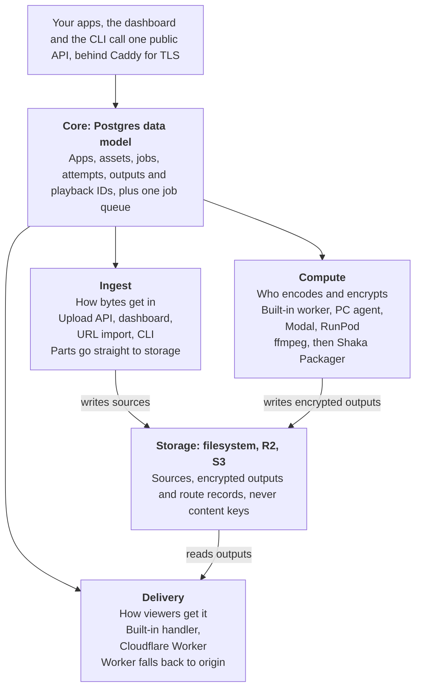
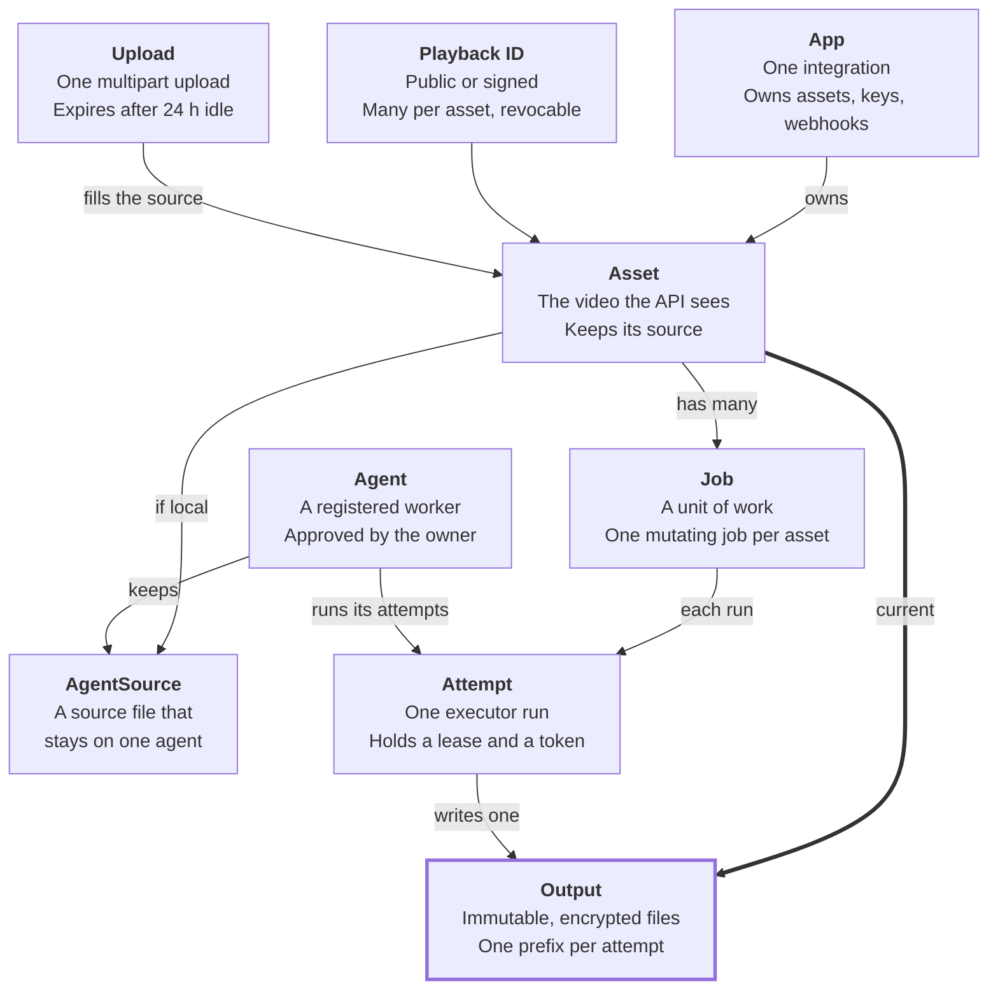
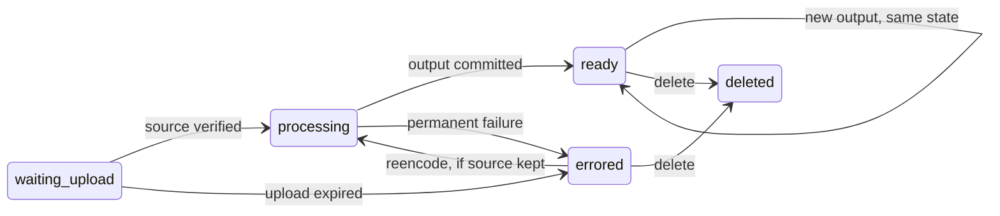
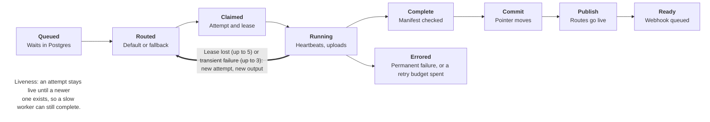
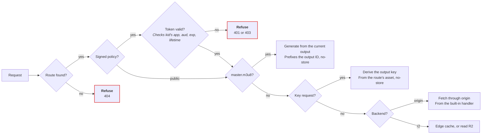

# Open-Source VOD Platform Architecture

Source: docs/architecture-v2.pdf (revised 2026-11-02). This Markdown is the working copy; when they disagree, fix this file to match the PDF unless a later decision in docs/decisions.md changes it.

Nov 1, 2026 · @Rahul Pratap · Revised Nov 2, 2026 after an architecture audit

## Overview

`clipmux` is an open-source, self-hosted alternative to Mux and Cloudflare Stream. Any app uploads a video, receives a playback ID, and streams it as encrypted HLS from infrastructure the owner controls.

Ingest, compute and delivery are independent layers that share one data model in Postgres. Each layer sits behind a narrow adapter, so the API your apps call stays the same when storage, compute or delivery changes.

It serves three kinds of user, and course platforms are only one use case:

- **The owner** runs the instance from the dashboard: upload, library, playback, jobs, workers, apps and setup.
- **Developers** connect any app through the API, webhooks and signed playback tokens. Each app has its own keys and sees only its own videos.
- **Viewers** watch through the built-in player or any HLS player.

**Three layers share one data model and stay independent**



*system architecture · three layers, one core, shared storage*

Workers reach the core only through the worker API, and the Cloudflare Worker reads route records from storage, so neither needs Postgres access.

### Design rules

- **Layers share data, not calls.** Ingest, compute and delivery only read and write the data model. Side effects outside Postgres, such as writing route records, run from outbox rows.
- **Postgres is the source of truth.** Route records in storage are a projection of it, and a reconciler repairs any drift.
- **The dashboard and CLI are API clients.** Neither has a private path.
- **Executors stay dumb.** They receive a job payload and a short-lived attempt token, never storage credentials.
- **Outputs are immutable.** A re-encode writes a new output, then a pointer moves.
- **Outputs are ciphertext.** Every output is encrypted with AES-128, and its key is derived at delivery, never stored.
- **One mutating job per asset.** A re-encode, a move and a delete never overlap on the same asset.
- **Playback doesn't need the control plane.** In Worker mode, videos stored in R2 keep playing while the control plane is down.

### Changes from the first draft

| Area | First draft | This version | Reason |
| --- | --- | --- | --- |
| Upload transport | tus or presigned PUT | S3 multipart with presigned parts | tus routes bytes through a server; a single PUT can't resume |
| Output writes | Presigned PUT prefix | Attempt token, URLs signed on request | A presigned URL covers one object |
| Storage layout | `media/{playback_id}/` | `media/{asset_id}/{output_id}/` | Supports rotation, multiple IDs and safe re-encodes |
| Worker policy | Inferred from the request | Route record, default deny | Removing a token must not bypass auth |
| Route lookup | Not specified (a review proposed Workers KV) | Route objects in the R2 bucket | No extra product, token scope or binding |
| Local storage default | MinIO | Built-in filesystem adapter | MinIO's community repo is archived |
| Default delivery | Direct from storage | Built-in handler with the same tokens | Signed playback works from day one |
| R2 public domain | Delivery adapter | Removed | A public bucket URL can't resolve playback IDs |
| Asset states | 7, including pipeline phases | 5, with phases on Job | A re-encode must not take an asset out of ready |
| Job execution | `Submit(job)` and a callback | Postgres queue, leases and attempts | Covers sleeping PCs and stale workers |
| Packaging | ffmpeg | ffmpeg encodes, Shaka Packager segments and encrypts | ffmpeg's HLS muxer can't encrypt fMP4 segments |
| AES-128 | Optional extra | On for every output, with keys derived at delivery | Stored outputs, cached copies and leaked segment URLs hold only ciphertext |

### Changes from the audit

| Area | Previous draft | This version | Reason |
| --- | --- | --- | --- |
| Route publishing | Commit called `Publish` between two transactions | `route_sync` outbox, idempotent publisher and a reconciler | A crash or R2 error left assets stuck in `processing`, and a failed `Unpublish` left revoked IDs playing |
| Jobs per asset | Fenced per job only | At most one mutating job per asset | Overlapping re-encodes could move the pointer backwards |
| Worker writes | Any relative path signed, any file served | Path grammar on sign, playlist check at commit, extension allowlist at delivery | Path traversal on the filesystem adapter, and hostile files served from the media domain |
| Worker keys | One long-lived key, not in the threat model | One key per agent, owner approval, revocation, optional local scope | A leaked key could read sources and replace outputs |
| PC agent sandbox | Open decision for Windows | Docker, WSL2 or a VM off Linux; unsandboxed agents get local jobs only | Public uploads would reach ffmpeg on a personal machine |
| Apps | One hidden project shared by every key | Apps own their keys, signing keys, webhook endpoints and assets; API keys carry scopes | Any app could read or delete every video |
| `master.m3u8` | Redirect to the pinned output | Generated per request with `{output_id}/` in front of each variant | Removes the main player risk, and tracks can be added later |
| Server signing | Server kept public keys only | An internal key for dashboard preview, setup tests and share links | Those features need a server-signed token |
| Delivery hostname | Per storage config | One media hostname per project; the route names the backend | `base_url` changed when storage did |
| Token audience | One kind of token | `aud` of `v` for playback or `t` for thumbnails | A poster token for a locked lesson could play the lesson |
| Token lifetime | Whatever the app's backend chose | `iat` required, project maximum enforced at delivery | A long-lived leaked token worked until the ID was rotated |
| Upload expiry | Abort 24 hours after creation | Abort after 24 hours with no new part, plus cancel and list-parts endpoints | Large uploads take longer than a day, and cancelled uploads were completed |
| Core model | Five objects | Adds App, Upload, Agent and AgentSource | The sweeper, resume, routing and revocation need them |
| Webhooks | Four asset events, no catch-up | Re-encode failure event, asset version, `GET /v1/assets` | Failed re-encodes were silent, and missed events were lost |
| Attempt liveness | A lease, plus a late-completion exception | One rule: the latest attempt of a job that isn't cancelled | `sign` and `heartbeat` disagreed with `complete` |
| Fallback | Queue age over 10 minutes | Queue-age fallback opt-in, with concurrency and spend limits | A bulk import turned into a bill |
| Cloudflare token | "Discard after setup" | Forget the raw value, keep the ID and hash; the token stays active | The S3 credentials are derived from the token |
| Filesystem uploads | Join the parts on completion | Write each part at its offset | A 300 GB join doubled disk use and timed out |
| First boot | No public URL step | Public URL, media hostname and TLS before any API key | Presigned URLs and `base_url` broke once the instance was exposed |
| Imports and long downloads | Not covered by `sign` | `sign` covers source parts and reissues source URLs | Imports write outside the output prefix |

## Core model

Every video is an Asset, and every playable version of it is an immutable Output. A single default project, hidden from the UI, owns every object plus adapter config. That keeps multi-tenancy open without showing it to anyone.

Inside the project, an App is the boundary between integrations. Each app owns its API keys, signing keys, webhook endpoints and the assets it creates. Dashboard uploads go to a built-in Dashboard app unless the owner picks another, and the dashboard sees every app's assets.

| Object | What it is | Key fields |
| --- | --- | --- |
| App | One integration, such as an LMS or a marketing site | `name`, plus the keys and webhook endpoints it owns |
| Asset | The video as the API sees it | `app_id`, `status`, `version`, `storage_id`, `source_uri`, `current_output_id`, `passthrough` |
| Output | An immutable set of encrypted files from one attempt | `prefix`, `manifest`, `key_version`, `status` |
| Job | A unit of work on an asset | `kind`, `status`, `phase`, `progress` |
| Attempt | One executor's run of a job | `executor`, `agent_id`, `lease_expires_at`, `token_hash`, `output_id`, `status` |
| Playback ID | The public handle for an asset | `policy`, `revoked_at` |
| Upload | A multipart upload in progress | `asset_id`, `multipart_id`, `declared_size`, `part_size`, `token_hash`, `last_activity_at`, `status` |
| Agent | A registered worker machine | `key_hash`, `status`, `scope`, `capabilities`, `sandbox`, `last_seen_at` |
| AgentSource | A source file that stays on an agent | `agent_id`, `size` |

**Playback IDs reach files through the current output of an asset**



*object model · nine objects, one movable pointer*

Only `current_output_id` moves. Everything an attempt writes stays where it is until cleanup. An asset's `version` goes up on every change, and webhooks carry it.

### Why Output exists

- **Attempts can't collide.** Each attempt writes to its own prefix, so a stale worker can't corrupt a newer run.
- **Re-encodes are atomic.** Viewers stay on the old output until the pointer moves.
- **Playback IDs stay cheap.** Rotating an ID changes a route and moves no objects, and one asset can have public and signed IDs together.
- **Cached files never go stale.** A path is never reused, so every object can be cached as immutable.
- **Each output has its own key.** A leaked key exposes one version of one video, and a re-encode brings a new key.

### Asset states

Assets have five states. Pipeline phases such as probe, transcode and package live on Job, so a ready asset stays ready during a re-encode. If that re-encode fails, the current output keeps playing and the app receives `video.asset.reencode_failed`.

**A ready asset stays ready while it is re-encoded**



*asset states · five states and their transitions*

An asset can be deleted from any state, but the drawing shows only the common paths. An errored asset whose source was kept can be retried with `reencode`. The API reference lists every error code, such as `upload_expired` and `upload_cancelled`.

Jobs use `queued`, `running`, `succeeded`, `failed` and `cancelled`. Attempts use `running`, `committed`, `failed` and `lost`. Outputs use `writing`, `committed` and `retired`. Uploads use `active`, `completed`, `cancelled` and `expired`. Agents use `pending`, `approved` and `revoked`.

### One mutating job per asset

Fencing an attempt protects a job from its own stale workers, but not from another job on the same asset. Without a rule, an older re-encode could commit last and move the pointer backwards. So an asset has at most one active mutating job, whether import, transcode, re-encode, move or delete. A partial unique index on active jobs enforces it.

- A second re-encode or move returns `409` with the running job's ID. Passing `supersede: true` cancels the running job first.
- A delete always wins. It runs in this order:
  1. Cancel the asset's active jobs, which fences their attempts.
  2. Unpublish every playback ID and wait for confirmation.
  3. Delete the asset's storage prefixes.
  4. Add `video.asset.deleted` to the webhook outbox.

### Storage layout

```text
uploads/{asset_id}/source
media/{asset_id}/{output_id}/...
_routes/{playback_id}.json
_keys.json
```

Sources are kept by default so assets can be re-encoded. A project can delete them after `ready`, which gives up re-encoding. Retired outputs are deleted after 7 days, so viewers mid-session can finish.

`_keys.json` holds public token-signing keys. No content key is ever written to storage, so outputs there are ciphertext only. Sources stay as uploaded.

Files from a failed or lost attempt are deleted 30 minutes after a newer attempt replaces it or the job ends. That outlasts the attempt's 15-minute PUT URLs, so a stale worker can't recreate files after cleanup. A daily sweep also deletes any output prefix with no `committed` or `writing` Output. Built-in delivery serves only the files a committed manifest lists, and 16 minutes after a commit, once its PUT URLs have expired, the retention loop deletes anything else under that output (D124).

### Accounts and tenancy

The open-source edition has one owner account. A multi-tenant cloud edition is future scope, and the data model is already ready for it.

- **Sign-up:** The first visitor registers with the setup token. Registration then closes, and the instance shows only a login page.
- **One login:** v1 has no teams, invites or roles. The owner does everything in the dashboard. A lost password is reset on the host with `clipmux admin reset-password`, and the owner can turn on TOTP.
- **Apps:** Integrations use API keys, never the owner's login. Each key belongs to one app and carries scopes such as `assets:read`, `assets:write` and `uploads:write`. No integration key can manage apps, keys, agents, adapters or settings. Revoking a key cuts off that key, and disabling an app cuts off everything it owns.
- **Cloud groundwork:** Every row carries `project_id`, and apps and adapter config belong to a project. Adding tenants changes sign-up, the UI and billing, not the data model.

## Ingest

Every ingest path ends the same way: a verified source exists, and the asset moves to `processing`.

| Path | Used by | How bytes move |
| --- | --- | --- |
| Direct upload | Any app, such as an LMS or a SaaS product | The browser sends multipart parts straight to storage |
| Dashboard upload | The owner | The same API with a UI on top |
| Import from URL | Migrations | A worker copies the URL to `uploads/{asset_id}/source`, then continues as an upload |
| `clipmux push` | Files on any machine | The CLI uses the same upload API |
| `clipmux push --local` | Files beside a PC agent | The source stays on that machine and only outputs are uploaded |

### Multipart upload flow

The design uses S3 multipart for everything because [tusd forwards bytes through its own server](https://tus.github.io/tusd/storage-backends/aws-s3/), and a single PUT can't resume. A single [R2 upload also tops out at 5 GiB](https://developers.cloudflare.com/r2/platform/limits/), which long recordings can exceed.

1. Your app's backend calls `POST /v1/uploads` with the file size, playback policy, a `passthrough` value and an `Idempotency-Key`.
2. The server creates the asset in `waiting_upload`, owned by the calling key's app, and an Upload record. It returns `upload_id`, `asset_id`, `part_size` and an `upload_token`, which stays valid while the upload is active.
3. The browser uses `upload_token` to request batches of part URLs. The server signs only parts within the declared size.
4. The browser PUTs each part straight to storage. A failed part retries on its own. The browser keeps `upload_id` and `upload_token` across a reload, and `GET /v1/uploads/{id}/parts` tells it which parts are already stored.
5. The browser calls `POST /v1/uploads/{id}/complete` with part numbers and ETags.
6. The server completes the upload, confirms the size with `Head`, moves the asset to `processing` and queues a job.

A user who stops an upload, or a backend that no longer wants it, calls `POST /v1/uploads/{id}/cancel`. The server aborts the multipart upload and marks the asset `errored` with `upload_cancelled`.

Uppy's S3 multipart support covers the browser side, including listing stored parts. Parts are a fixed 32 MiB because R2 requires equal sizes except for the last part, which allows sources up to about 312 GiB. Setup must apply bucket CORS that exposes `ETag`, or the browser can't read part ETags. `AllowedOrigins` is `*`, because the presigned URL is the authorisation, so adding an app needs no CORS change.

### Abandoned uploads

A closed tab must not strand an upload, and a slow upload must not be killed. A sweeper checks active uploads every 5 minutes. A part URL request or a newly stored part counts as activity.

- If the stored parts add up to the declared size, it completes the upload. It never completes a cancelled one.
- If an upload has had no activity for 24 hours, it aborts the upload and marks the asset `errored` with `upload_expired`. The limit is on inactivity, not age, because a 312 GiB source on a 20 Mbps uplink takes about 37 hours.

### Local sources

`clipmux push --local ./videos` avoids uploading a source only to download it again. The CLI hands each file to the local agent, which registers it with the server and transcodes it in place.

- **Source reference:** The asset stores `agent://{agent_id}/{source_id}`, backed by an AgentSource record. The real path stays on the agent, so the server can't ask for an arbitrary file.
- **Pinned job:** The job can only run on that agent, so fallback doesn't apply.
- **Re-encoding:** It needs the same agent and file, unless the push used `--upload-source`.

## Compute

All work goes through one Postgres queue (`FOR UPDATE SKIP LOCKED`), and every executor claims it through the same worker API. No executor has a separate path, and v1 needs no Redis.

| Executor | How a worker starts | Network needs | Best for |
| --- | --- | --- | --- |
| Built-in | `serve` starts a child `clipmux worker` over loopback | Local only | The default |
| PC agent | `clipmux worker --server URL --key KEY`, then the owner approves it | Outbound only, so it works behind NAT | A GPU you already own |
| Modal / RunPod | The dispatcher starts `clipmux worker --once` | Outbound, plus a public server URL | Fallback and bursts |

The built-in worker uses this API from day one, so the contract is tested before any other executor exists. Serverless workers receive a one-time key that can claim a single job.

Each PC agent has its own key, because a worker key can read sources and write outputs. A new agent appears on the Workers page as `pending` and claims nothing until the owner approves it. The page lists each agent's last-seen time, IP, ffmpeg and Shaka Packager versions and sandbox status, and revokes an agent in one click. An agent can be scoped to `local`, so it claims only jobs pinned to it. Each attempt records its agent, so a revoked agent's outputs can be found and re-encoded.

**A lost lease returns the job to routing, and the retry writes a new output**



*attempt lifecycle · from queue to ready, with the retry loop*

Every retry gets a fresh attempt and output, so a failed run can't leave partial files in the path viewers use.

### Worker API

| Call | Purpose |
| --- | --- |
| `POST /worker/v1/claim` | Long-polls for work, then creates an attempt and lease |
| `POST /worker/v1/attempts/{id}/heartbeat` | Reports phase and progress, extends the lease, and can tell the worker to stop |
| `POST /worker/v1/attempts/{id}/sign` | Returns presigned URLs for a batch of output paths, source parts for an import, or a fresh source GET URL |
| `POST /worker/v1/attempts/{id}/complete` | Submits the manifest for commit, or a transcription's canonical transcript (`{transcript}`), which serve validates, renders to WebVTT, encrypts and stores |
| `GET /worker/v1/attempts/{id}/audio` | A transcription's input: the output's audio rendition decrypted by serve, as one fragmented MP4 (P5-T14) |
| `POST /worker/v1/attempts/{id}/fail` | Reports a transient or permanent failure |

### Job payload

```json
{
  "contract_version": 2,
  "attempt_id": "att_01",
  "attempt_token": "...",
  "lease_seconds": 90,
  "source": { "url": "https://...", "size": 4294967296 },
  "profile": { "id": "default", "version": 1 },
  "renditions": ["1080p", "720p", "480p", "360p"],
  "output_format": 1,
  "encryption": { "method": "aes-128", "key_version": 1, "key": "..." }
}
```

The payload holds no storage credentials, and the attempt token works for this attempt only. A pinned job replaces `url` with `agent_source_id`.

A claim names the job kinds it takes (`kinds`; absent means the media kinds) and, from a worker whose start-up probe proved whisper, `speech: {backends, model}`. A transcription's payload carries `speech: {input_output_id, duration_seconds, model}` instead of a source, an output and a key: the worker reads the audio from `GET …/audio` and never writes a file (D078, D079).

The content key is derived at claim time, like the URLs, and opens only this attempt's output. The worker already holds the plaintext source, so the key shows it nothing new.

[Presigned URLs cover one object](https://developers.cloudflare.com/r2/api/s3/presigned-urls/), and segment names aren't known until packaging runs. So the worker sends relative paths to sign as it goes, and the server adds the prefix. An attempt therefore can't write outside its own output.

URLs are minted at claim time or later, never at enqueue, so a job waiting for an offline PC holds nothing that expires. PUT URLs last 15 minutes and source GET URLs last 1 hour. A worker whose source download drops after its URL expires asks `sign` for a new one. An import attempt uses `sign` for the multipart parts of `uploads/{asset_id}/source` instead of an output prefix.

### Write path checks

The worker's file names and files are untrusted, because a compromised ffmpeg writes into the same work directory the worker uploads from.

- **Path grammar:** `sign` accepts only names from the output format: `manifest.json`, `master.m3u8`, `poster.jpg`, and a `{height}p/` or `audio/` directory holding `index.m3u8`, `init.mp4` and `seg_{n}.m4s`. It rejects everything else, including `..`, and caps file count and total bytes per attempt. The grammar has no name for a key file, so a content key can't be uploaded.
- **Worker filter:** The worker uploads only files that match the same grammar and ignores anything else in the work directory.
- **Commit check:** The server parses every playlist, which are small, and rejects any URI that isn't relative or isn't in the listing, apart from the key URI. Every media playlist must carry `METHOD=AES-128` with exactly the expected key URI, so an unencrypted output can't commit.

### Leases

Workers send a heartbeat every 15 seconds, and a lease lasts 90 seconds.

- **Liveness:** An attempt is live while it's the latest attempt of a job that isn't cancelled. `heartbeat`, `sign` and `complete` all check this one rule.
- **Lost lease:** The attempt is marked `lost` and the job returns to routing. It stays live until a newer attempt exists, so a worker that was only slow can heartbeat back to `running` or complete.
- **Stale worker:** Once a newer attempt exists, the old one's next call tells it to stop. Its files sit in an unreferenced prefix until cleanup.
- **Retry budgets:** Lost leases and reported failures have separate budgets, 5 and 3. A PC that sleeps through a job doesn't use up the retries meant for bad files, and a file that kills the worker still stops after 5.

### Commit

1. The server compares the manifest with a `List` of the output prefix and runs the commit check on the playlists.
2. One transaction marks the output `committed`, moves `current_output_id`, retires the previous output, and writes a `route_sync` outbox row for each of the asset's playback IDs.
3. The route publisher writes each route record through the delivery adapter. Every write is idempotent, and a failed write is retried.
4. Once every route is confirmed, a second transaction moves the asset to `ready` and adds `video.asset.ready` to the webhook outbox.

Routes publish before `ready`, so an app never receives a webhook for a playback ID that doesn't work yet. A crash at any step resumes from the outbox. A re-encode ends with `video.asset.updated` instead.

### Routing and fallback

Settings hold one default executor and an optional fallback, such as "Modal, else this server". v1 has no scoring scheduler. The dashboard offers one choice, this server or a connected cloud GPU, and a cloud GPU becomes the primary by itself once its connect test passes (D116); the API keeps the full table below.

| Condition | Action |
| --- | --- |
| Primary has no heartbeat for 60 seconds | Route to the fallback |
| Job queued for more than 10 minutes, if queue-age fallback is on (off by default) | Route to the fallback |
| Lease lost | Retry, on the fallback if the primary is still offline |
| Transient failure, such as network, disk or a worker crash | Retry with backoff, up to 3 failures |
| Permanent failure, such as a corrupt or unsupported source | Mark the asset `errored`, with no fallback |
| Source pinned to an agent | Wait for that agent, with no fallback |

Fallback has two limits, both set when the owner connects the provider: concurrent fallback jobs and monthly spend, estimated from job duration and the provider's rate. When a limit is reached, jobs wait for the primary. The Jobs page shows where each job ran, each attempt, and why it was routed there.

### Output format

The output format is the real contract between compute and delivery, so it carries a version.

```text
media/{asset_id}/{output_id}/
  manifest.json    renditions, duration, sizes, tool versions, key version
  master.m3u8
  poster.jpg
  720p/index.m3u8
  720p/init.mp4
  720p/seg_00001.m4s
  audio/index.m3u8
  audio/init.mp4
  audio/seg_00001.m4s
```

- **Encoding:** ffmpeg encodes the whole ladder in one pass, H.264 video and AAC audio, with keyframes aligned across renditions. The results stay on the worker's disk.
- **Packaging:** Shaka Packager cuts those files into CMAF fMP4 segments, encrypts each whole segment with AES-128 and writes the playlists. [ffmpeg's HLS muxer refuses to encrypt fMP4](https://github.com/FFmpeg/FFmpeg/blob/master/libavformat/hlsenc.c), and [Shaka Packager added AES-128 for MP4 in 3.8 and fixed it for CMAF in 3.9.1](https://github.com/shaka-project/shaka-packager/releases), so workers need 3.9.1 or later.
- **Audio:** Shaka Packager writes one stream per output, so audio is its own rendition, shared by every video rendition. This replaces muxed audio and doubles segment requests.
- **Ladder:** 2160p, 1440p, 1080p, 720p, 480p and 360p, capped at the source's short side (and 4096 on the long side), or the renditions the upload chose (D130).
- **Segments:** 6 seconds, for video and audio alike.
- **Paths:** Playlists use relative URLs only, including the key URI.
- **One attempt, all renditions:** A single attempt encodes and packages the whole ladder, so renditions always align.
- **Not served:** `manifest.json` is for the control plane, and delivery refuses it.

Workers report their ffmpeg and Shaka Packager versions, encoders and free disk when claiming. The server skips a worker that can't meet the profile or contract version, which matters because PC agents will drift.

## Delivery

Delivery turns a playback ID into bytes, and it decides from a route record rather than from the shape of the URL. Unknown IDs are refused by default.

| Adapter | Serves | Best for |
| --- | --- | --- |
| Built-in handler | Any storage, with bytes passing through the app | Getting started, small audiences, private deployments |
| Cloudflare Worker | R2 through a binding, cached at the edge | Production |

Both adapters use the same hostname, URLs, tokens, key derivation and lookup rules, so the Worker is a CDN upgrade rather than a feature gate. Signed, encrypted playback works on a fresh install.

### URLs

```text
Signed: https://media.domain.com/v/{token}/{playback_id}/master.m3u8
Public: https://media.domain.com/p/{playback_id}/master.m3u8
```

The project has one media hostname, chosen at first boot. The API returns it as `base_url`, and it doesn't change when storage or delivery does, so apps store only the playback ID.

Delivery generates `master.m3u8` on each request. It reads the stored master of the route's current output and puts `{output_id}/` in front of each video and audio playlist URI, so `720p/index.m3u8` becomes `{output_id}/720p/index.m3u8`. The player resolves that against the master's URL and lands on `.../{playback_id}/{output_id}/720p/index.m3u8` with no redirect. That pins a session to one output, because a re-encode can change segment boundaries and keys. Because the master is generated, captions and extra audio tracks can later be added to it without a new output. Subtitles are added this way (P5-T15, D081): each subtitles track being published or ready gets an `#EXT-X-MEDIA:TYPE=SUBTITLES` line pointing at `tracks/{track_id}.m3u8`, a one-segment playlist of `tracks/{track_id}.vtt`, which delivery decrypts from `media/{asset_id}/tracks/{track_id}.vtt`. The same VTT URL is the sidecar a player loads directly; chapters are a VTT at the same path, never listed.

### Route records

```json
{ "v": 1, "app_id": "...", "asset_id": "...", "output_id": "...", "policy": "signed", "backend": "r2" }
```

Records also carry `outputs` (the servable outputs and their key versions), `tracks`, and two fields delivery counts by (D103): `no_audio`, the outputs whose video segments carry the watch time, and `share`, set on a share link's playback ID. The route publisher writes this object to `_routes/{playback_id}.json` through the storage adapter, and the Worker reads it through its R2 binding. Deleting the object revokes the ID. The built-in handler reads the same data from Postgres. Storage keys use the route's asset ID, so a token for one video can't read another, and a token's `kid` must belong to the route's app.

`backend` is `r2` for assets in the Worker's bucket, or `origin` for assets on other storage. The Worker fetches origin assets from the built-in handler at the app's public URL, until a `move` job brings them into R2.

Route records are a projection of Postgres, so they can't be allowed to drift:

- **Writes:** Every change goes through the `route_sync` outbox, so a failed write is retried rather than lost.
- **Revocation:** `DELETE /v1/assets/{id}/playback-ids/{pid}` returns once the unpublish is confirmed. If storage can't be reached, it returns `202`, and the playback ID shows `revoking` until the unpublish succeeds.
- **Reconciler:** Every 15 minutes, the control plane lists `_routes/` and compares it with Postgres. It deletes routes for revoked or unknown IDs and rewrites any that differ.

An earlier review proposed Workers KV, but the bucket is simpler. It adds no product, binding or token scope, and [R2 reads through a binding are strongly consistent](https://developers.cloudflare.com/r2/reference/consistency/). The Worker caches each route and `_keys.json` for up to 60 seconds, so revocation takes up to a minute.

**Delivery refuses by default and serves only after every check passes**



*Worker request flow · three checks, two refusals, four answers*

The built-in handler follows the same checks, but it reads storage directly and has no edge cache.

### Responses

Delivery serves bytes a worker wrote, so it doesn't trust them.

- **Types:** It serves only `.m3u8`, `.mp4`, `.m4s` and `.jpg`, plus the key path, which never touches storage. It sets `Content-Type` from the extension, never from stored metadata. Every response carries `X-Content-Type-Options: nosniff`.
- **Errors:** A status tells the player what to do. `401 token_expired` means fetch a new token, `403 denied` means stop, and `404` means the ID is unknown.
- **Domain:** The media hostname should sit on a different registrable domain from the dashboard, so a bad file can't reach dashboard cookies. If they share one, dashboard cookies must be host-only.

### Caching and cost

The cache key is the storage key, so tokens and playback IDs don't fragment the cache. Pinned paths are served as immutable for a year. The generated `master.m3u8` and every key response are `no-store`.

The Worker runs on every request, including cache hits. With 6-second segments and audio as its own rendition, a player fetches two segments every 6 seconds, about 1,200 requests per viewer-hour. Key requests add only a few per session.

| [Workers plan](https://developers.cloudflare.com/workers/platform/pricing/) | Included requests | Approximate viewing covered |
| --- | --- | --- |
| Free | 100,000 per day | 83 viewer-hours per day |
| Paid ($5 per month minimum) | 10 million per month, then $0.30 per million | 8,300 viewer-hours per month, then about $0.36 per 1,000 viewer-hours |

The Worker adapter should require Workers Paid. Beyond the quota, [Cloudflare's CDN terms](https://www.cloudflare.com/service-specific-terms-application-services/) say video needs a Paid Service such as the Developer Platform.

[The Cache API doesn't replicate between data centers or support tiered caching](https://developers.cloudflare.com/workers/runtime-apis/cache/), so each location's first request for a segment reads R2.

### Tokens

Tokens are ES256 JWTs placed in the URL path, so relative playlist URLs inherit them without any player hooks. The key URI is relative too, so key requests carry the token the same way.

- **Signing keys:** The dashboard generates a key pair for an app, shows the private key once and keeps only the public key. The app's backend signs and delivery verifies.
- **Internal key:** The server also holds one key pair of its own, encrypted like adapter secrets, under its own `kid`. It signs only short-lived tokens, for dashboard preview, setup tests and share links.
- **Claims:** `sub` holds the playback ID, `aud` is `v` for playback or `t` for thumbnails, `iat` the issue time, `exp` the expiry, and an optional `vid` a viewer ID, which analytics counts as a keyed hash (D103).
- **Audiences:** A `t` token fetches only `poster.jpg`, so a catalogue can show posters for locked lessons without handing out a token that plays them. A `v` token fetches everything, including the content key.
- **Lifetime:** `exp` is the current time plus the larger of 2 × duration or 4 hours. [Mux notes that an expired URL stops playing even mid-session](https://www.mux.com/docs/guides/secure-video-playback). Delivery rejects any token whose `exp − iat` exceeds the project maximum, which defaults to 7 days to match the retire window.
- **Refresh:** The built-in player accepts a `getToken()` callback. On a `401`, it fetches a new token and resumes at the same position. Players it doesn't control, such as AirPlay and Chromecast receivers, can't refresh, so the lifetime rule is what keeps them playing.
- **Rotation:** `_keys.json` holds active public keys by `kid`. Rotating adds a new key and retires the old one after the maximum token lifetime, so it needs no Worker deploy and doesn't end live sessions.
- **Revocation:** Revoking a leaked key removes it from `_keys.json` at once, which ends its sessions within the 60-second cache.

### Content protection

Every output is encrypted with AES-128. Delivery hands out an output's key only to a request that passes the same checks as its segments, so encryption is a layer behind tokens, not a replacement for them.

- **Key URL:** Each media playlist names its key as `../key/{key_version}`, which resolves to `.../{playback_id}/{output_id}/key/{key_version}` with the token still in the path. Delivery answers with 16 bytes and `Cache-Control: no-store`. A `t` token can't fetch it, and a public playback ID serves it without a token, so one output works for both policies.
- **Derivation:** The key is the first 16 bytes of an HMAC-SHA256 over the route's asset ID and the output ID, keyed with the project's content key secret. Deriving from the route's asset means a token for one video can't fetch another video's key, and nothing needs a key table.
- **Secret:** The control plane holds the secret, encrypted like adapter secrets. The Cloudflare Worker holds it as a Worker secret, set when Connect Cloudflare deploys it. Workers that encode receive only their own output's key, at claim time.
- **Rotation:** Each output records the secret's version, and the key URL carries it. A new version applies to new outputs, and delivery keeps every version that an output still uses. If the secret leaks, rotate it and re-encode the affected outputs.

Encryption buys two things. Stored outputs are ciphertext, so a leaked bucket, stolen R2 credentials or a copied disk exposes no playable output. Sources stay as uploaded, so a project that deletes them after `ready` leaves nothing playable in storage. A segment URL or cached copy that escapes its token is also useless without the key.

It is still deterrence, not DRM. Anyone with a valid token can fetch the key, and common download tools do that automatically, so the docs should say so.

Widevine and FairPlay can come later without re-encoding. Shaka Packager already writes CMAF with `cbcs` encryption for both, and because the server can derive every key, existing outputs can be decrypted and repackaged. DRM also needs a licence server, which v1 doesn't have.

### Analytics

Delivery counts what it serves, in whichever adapter answers the viewer (D103). There is no player beacon, so analytics needs nothing from the app but an optional `vid`.

- **What counts:** a `GET` answered 200, or 206 from byte 0, on a servable route. A view is one generated `master.m3u8`. Watch time is 6 seconds per audio segment, or per video segment for an output with no audio, so ABR switches don't double it; it overcounts by the player's buffer-ahead. Bytes are every counted body, and a range not from byte 0 adds bytes only. Refusals never count.
- **What doesn't:** tokens signed by the internal key (dashboard previews, posters, the setup test), except a share link's, whose route is marked `share`; and requests the Worker forwards to origin, which carry `X-ClipMux-Edge: 1` because the Worker counted them already.
- **Viewers:** a viewer key is HMAC-SHA256 of `app_id ‖ 0 ‖ vid` under a per-project analytics key, cut to 16 bytes and kept per day per asset. Unique viewers count distinct keys across a range's days, or read `null` when no view carried a `vid`.
- **Built in:** the handler records into an in-memory recorder that every replica flushes to Postgres every 15 seconds, adding to `playback_hourly` and `playback_daily` and inserting viewer keys. serve flushes once more at shutdown.
- **At the edge:** the Worker writes one Analytics Engine data point per counted response. With a read-only token the owner connects, serve pulls them every 5 minutes, recomputing from an hour before its last pull and replacing those hours' edge rows, so a repeated pull never double counts. Origin and edge rows are kept apart by a `source` column.
- **Kept:** hourly rows 14 days, for the 24-hour range; daily rows and viewer keys 180 days, two 90-day ranges (D105). Nothing stores an IP, User-Agent, referrer, token or raw `vid`.
- **Read:** `GET /v1/analytics` and `/v1/analytics/assets/{id}` (D100) for the owner, and for an app's key with the opt-in `analytics:read` scope, its own assets only. `collecting` says whether the edge is counted.

## Adapters

Core logic calls three Go interfaces and never branches on a vendor. A user's choices are saved as per-project config in Postgres, and the core loads the matching adapter at runtime. Signatures below are shortened.

```go
type Storage interface {
    CreateMultipart(key) (uploadID, error)
    PresignPart(key, uploadID, part, ttl) (url, error)
    ListParts(key, uploadID) ([]Part, error)
    CompleteMultipart(key, uploadID, parts) error
    AbortMultipart(key, uploadID) error
    PresignGet(key, ttl) (url, error)
    PresignPut(key, ttl) (url, error)
    Put(key, body) error
    Get(key) (body, error)
    Head(key) (Object, error)
    List(prefix, cursor) ([]Object, next, error)
    DeletePrefix(prefix) error
    Capabilities() StorageCaps
}

type Executor interface {
    Available() (bool, error)        // agent heartbeat or provider check
    Wake(job) error                  // starts a worker; no-op for pull
    Capabilities() ExecutorCaps
}

type Delivery interface {
    BaseURL() string
    Publish(route) error             // idempotent; called only by the route publisher
    Unpublish(playbackID) error      // idempotent
    Routes(cursor) ([]Route, next, error) // for the reconciler
    Capabilities() DeliveryCaps
}
```

| Interface | v1 adapters | Later |
| --- | --- | --- |
| Storage | Filesystem, R2, S3 | Backblaze |
| Executor | Built-in, PC agent, Modal, RunPod | Vast.ai |
| Delivery | Built-in handler, Cloudflare Worker | Bunny |

The filesystem adapter keeps the same contract by issuing app-signed URLs that the app serves itself. It preallocates the source at the declared size and writes each part at offset (n − 1) × part size, so completion has nothing to join. It refuses any key containing `..`, as a second line behind the path grammar. Anyone who wants local S3 can use the S3 adapter with [Garage or SeaweedFS](https://pinggy.io/blog/minio_archived_self_hosted_s3_alternatives/).

### Per-asset storage

Each asset records two stores (D117): `storage_id` holds its source (`uploads/{asset}/…`) and comes from the project default, which the Storage page sets; `media_storage_id` holds its outputs and tracks (`media/{asset}/…`) and is the media target when the asset is created: the Cloudflare delivery bucket while the Worker delivers, otherwise the default store, beside the source. Delivery belongs to the project, not to a storage config. The route's `backend` tells the Worker whether to read its own bucket (the asset's encoded files are there) or fetch from the built-in handler.

Changing either target leaves old assets where they are, so they keep playing at the same URLs. A `move` job puts each part where the settings now say: it copies the source to the default store and the servable outputs and tracks to the media target, skipping a part that is already there, then republishes its routes. Nothing redirects, because the hostname never changed. Encrypted outputs move as they are, because their keys depend only on IDs.

`move` and `delete` are internal jobs that run in the control plane, because they need storage credentials. Executors only run media work.

### Compatibility

Capabilities are pairwise, so `Capabilities()` reports reachability, and the dashboard shows only valid combinations.

| Combination | Result | Why |
| --- | --- | --- |
| Filesystem + built-in worker | Works | Same machine |
| Filesystem + PC agent | Works if the agent can reach the app | Signed URLs point at the app |
| Filesystem + Modal or RunPod | Needs a public app URL | The provider must reach the app |
| Filesystem + Worker | Through origin only | The binding only reaches R2, so the Worker fetches these assets from the built-in handler until they move |
| R2 or S3 + built-in delivery | Works | Bytes pass through the app |
| R2 + Worker | Recommended for production | Edge cache and no app in the path |
| S3 + Worker | Through origin only in v1 | The Worker would have to sign S3 requests |
| Private control plane + Modal or RunPod | Invalid | Workers can't reach the worker API |

Presigned URLs are also bound to a hostname. The app must sign with the public endpoint, because a URL signed for an internal Docker hostname fails in a browser.

### Guardrails

- **Keep interfaces narrow.** If the core needs vendor-specific behaviour, an interface is leaking.
- **Test the whole path.** A test on one adapter can't catch a bad combination, so setup finishes with a real end-to-end job.

## Integration API

An app needs one API key, one signing key and one webhook endpoint, all created for that app in the dashboard. None of these change when the infrastructure behind them does, and none of them reach another app's videos.

| Endpoint | Called by | Purpose |
| --- | --- | --- |
| `POST /v1/uploads` | Backend | Create an asset and multipart upload |
| `GET /v1/uploads/{id}/parts` | Browser, with `upload_token` | List stored parts to resume |
| `POST /v1/uploads/{id}/parts` | Browser, with `upload_token` | Get presigned part URLs |
| `POST /v1/uploads/{id}/complete` | Browser, with `upload_token` | Finish the upload |
| `POST /v1/uploads/{id}/cancel` | Browser or backend | Abort the upload |
| `POST /v1/assets` | Backend | Import from a URL or register an agent source |
| `GET /v1/assets` | Backend | List the app's assets, filtered by `passthrough` or `updated_since` |
| `GET /v1/assets/{id}` | Backend | Read status, version, outputs and playback IDs |
| `DELETE /v1/assets/{id}` | Backend | Delete an asset and its files |
| `POST /v1/assets/{id}/reencode` | Backend | Create a new output |
| `POST /v1/assets/{id}/playback-ids` | Backend | Add a public or signed ID |
| `DELETE /v1/assets/{id}/playback-ids/{pid}` | Backend | Revoke an ID |
| `POST /v1/assets/{id}/shares` | Backend or dashboard | Create a share link, with its own signed playback ID |
| `GET /v1/assets/{id}/shares` | Backend or dashboard | List an asset's share links and their views |
| `DELETE /v1/shares/{id}` | Backend or dashboard | Revoke a share link |
| `GET /v1/analytics` | Backend (`analytics:read`) or dashboard | Views, watch time, viewers and bandwidth for a range |

Every POST accepts an `Idempotency-Key`, so a retried request can't create a duplicate asset. Every call sees only the calling app's assets. Playback IDs on an asset that isn't ready yet carry `playable: false`.

### Integration flow

1. The app's backend calls `POST /v1/uploads` with `passthrough` set to its own record ID.
2. The browser uploads the file straight to storage.
3. `video.asset.ready` arrives with `passthrough`, the playback ID and the asset's `version`, and the app stores the playback ID. `base_url` is the same for every asset, so it belongs in config.
4. A viewer opens a page. The app applies its own access rules and signs a `v` token. Catalogue pages sign `t` tokens for posters.
5. The player loads the signed URL and fetches the key with the same token, and delivery validates every request.

For a course platform, `passthrough` is a lesson ID and the access rule is enrolment. A SaaS product might use a workspace ID and a seat check.

Owners who don't write code can skip the API. They upload in the dashboard, then copy a player embed for a public playback ID, or a share link for a private video.

### Share links

A share link (D104) is `{public_url}/s/{secret}`: a page that plays one video for anyone holding it, with no session and no app token.

- **Its own playback ID.** Each link owns one signed playback ID, created with it, so the owner can end one link without the others. Revoking the link revokes the ID through the usual unpublish; deleting the video revokes every link. Previews, posters and "Make private" never use or touch a link's ID.
- **A page, not a token.** The page is static. Its script reads the secret from the path and asks `POST /s/{secret}/playback` for a `v` token signed with the internal key, again whenever the player needs a fresh one, so a link can outlive the longest token. Each token lasts until the earliest of the link's expiry, max(2 × duration, 4 h) and the project maximum.
- **The secret** is about 130 random bits, looked up by its SHA-256 and sealed for the owner to copy again. It never appears in a log line.
- **Expiry** is enforced twice: tokens never outlive the link, and a leader loop revokes expired links' IDs every minute, so their route records leave the Worker too.
- **For other players**, a link can also hand out a plain signed HLS URL. It can't refresh, lasts at most the project maximum, and stops when the link is revoked.
- **Counted.** A link's plays count in analytics, though the internal key signs them, and the page sends a random per-browser `vid`, so links count unique viewers.

### Webhooks

- **Reliability:** Events go through an outbox written in the same transaction as the state change, so a crash can't lose one.
- **Delivery:** Events are at least once and unordered, so receivers dedupe on `event.id`. Each event carries the full asset with its `version`, so a receiver can ignore anything older than what it has stored. The server retries with backoff for 24 hours.
- **Catch-up:** An app that was down for longer calls `GET /v1/assets?updated_since=…`.
- **Scope:** An app's endpoints receive only events for that app's assets.
- **Signing:** Each request carries an HMAC-SHA256 signature over the timestamp and body, which also blocks replays.
- **Events:** `video.asset.ready`, `video.asset.updated`, `video.asset.reencode_failed`, `video.asset.errored` and `video.asset.deleted`.
- **Local development:** `npx @clipmux/node listen --forward-to localhost:3000/api/clipmux/webhook` relays an app's events to a laptop that can't receive webhooks, signed with the app's own webhook secret. `clipmux listen` does the same for a backend in any language, with a secret of its own.

## Security

The design treats every uploaded file as hostile and assumes any single secret can leak. ffmpeg parses untrusted input, and in this system it can run beside the database or on a personal PC.

### Worker sandbox

The worker downloads the source to local disk before ffmpeg starts, so ffmpeg never needs network access. Every ffmpeg, ffprobe and Shaka Packager process then runs with these limits:

- No network access
- An empty environment with no secrets, apart from the content key the packager needs for this output
- Read access to the source file and write access to one work directory only
- CPU, memory and wall-clock limits
- An allowlist of input demuxers that excludes HLS playlists and concat files

The demuxer allowlist matters because [a file disguised as an HLS playlist can pull local files into the output](https://ffmpeg.org/pipermail/ffmpeg-devel/2017-May/211816.html). That includes passwords and private keys, so a protocol whitelist alone isn't enough.

The Linux sandbox doesn't carry over to Windows or macOS, so there the agent runs inside Docker, WSL2 or a VM. An agent without a sandbox receives only jobs pinned to it with `push --local` and assets the owner uploaded in the dashboard, never public uploads. The Workers page shows each agent's sandbox status.

The built-in worker is a separate process that holds only an attempt token. It has no database or storage credentials, and its CPU is capped so encoding can't starve the API.

### Threats and controls

| Threat | Control |
| --- | --- |
| Hostile media exploits ffmpeg or the packager | Worker sandbox, plus no credentials in the worker |
| Unsandboxed agent processes public uploads | Docker, WSL2 or a VM off Linux; unsandboxed agents get local and owner jobs only; the Dashboard app takes no API keys and owner jobs exclude URL imports (D123) |
| Worker writes outside its output, or uploads hostile files | Path grammar on sign, worker-side filter and the playlist check at commit |
| Hostile file served from the media domain | Extension allowlist, `Content-Type` from the extension, `nosniff` and a separate domain |
| Worker or agent key leaked | One key per agent, owner approval, one-click revocation and an optional local scope; attempts record the agent, so its outputs can be found and re-encoded |
| A provider's machine sees one job's plaintext source and its output's content key | The same as any worker: signed URLs and an attempt token, no storage credentials, tools always sandboxed (`sandbox_required`), RunPod on Secure Cloud only, and the machine stopped when its attempt ends |
| A one-time dispatch key leaked | It claims only its own job, only while its dispatch is waking and before its claim deadline; it is stored hashed, passed in the environment and never argv, and spent by the claim |
| A file that kills the encoder runs up a provider's bill | Fallback only for jobs whose asset has failed for capacity alone, per asset and across re-encodes; per-provider concurrency and monthly spend limits |
| A crash leaves a paid machine running | Wakes and stops go through the outbox, machines are named for their dispatch, and the reaper and the reconciler (at boot and every 15 minutes) stop any machine no live dispatch accounts for |
| SSRF through import from URL | HTTP and HTTPS only, with private, loopback and link-local ranges blocked after DNS and on every redirect |
| Server asks an agent for arbitrary files | Opaque source IDs, with real paths kept on the agent |
| Token stripped from a signed URL | Route record policy, default deny |
| Playback token shared | `vid` claim, counted as a keyed hash per viewer (D103), and revocation by rotating the playback ID |
| A share link is passed on | It plays until it expires or is revoked; one link per recipient, so one can end without the others. Built-in delivery refuses a revoked link's ID at once, the Worker within its 60-second route cache |
| Share secrets guessed | About 130 bits, looked up by hash; failed lookups count toward the playback refusal limiter (D067), and plays are limited per address |
| A share link's stream URL leaks | It lasts at most the project maximum (7 days) and stops when the link is revoked |
| Analytics identify a viewer | Only keyed hashes of `vid` are kept, per day, for 180 days; no IP, User-Agent, referrer or token is stored, at the origin or in Analytics Engine |
| The edge analytics token leaks | It has only Account Analytics: Read; it is sealed with the secrets key and never returned |
| Long-lived playback token leaked | `iat` required, and a maximum lifetime enforced at delivery |
| Signing key leaked | Asymmetric per-app keys, with immediate revocation by `kid` |
| Bucket, R2 credentials or a storage disk leaked | Outputs are AES-128 encrypted and no content key is written to storage; sources stay readable unless the project deletes them after `ready` |
| Content key leaked | One key per output, so a leak exposes one version of one video; a re-encode brings a new key |
| Content key secret leaked | A new secret version and re-encoding; the secret lives only in the control plane, encrypted, and as a Worker secret |
| One app reads or deletes another app's videos | App-owned assets and keys, scoped API keys, and each token's `kid` checked against the route's app |
| Revocation fails at storage | `route_sync` outbox, confirmed unpublish and the reconciler |
| Stale worker overwrites a newer run | Per-attempt output prefixes and server-side fencing |
| Upload abuse | Declared size limits, scoped `upload_token` and signing only within that size |
| Someone claims the owner account first | Setup token on by default, printed to the logs |
| Secrets read from the database | Adapter secrets, the internal signing key and the content key secret encrypted with a key held outside Postgres |
| Cloudflare token stolen | The app forgets the raw token after setup and keeps only the ID and hash its S3 credentials need. A stolen token can still deploy a Worker that reads Worker secrets, so revoke it and rotate the content key secret |
| Forged webhooks | HMAC signature with a timestamp |
| Subtitles or chapters read from storage | Each track's VTT sealed with AES-128-GCM under a key derived per track from the content key secret, with the storage key as associated data, so a tampered or moved object doesn't open; the Cloudflare Worker caches the ciphertext and decrypts after its cache (D079, D081) |
| A thumbnail token reads a transcript | `t` tokens get 403 on `tracks/`; the transcript API needs an API key or the owner's session |
| Transcript text sent to the chapters LLM, or audio to a speech API | Off until the owner connects one; the Connect card and docs say what leaves; only the transcript (chapters) or the output's audio (speech) is sent, never a source, a key or another asset's data (D075, D083) |
| Speech tells the LLM to ignore its rules (prompt injection) | The transcript goes as delimited data with its `<` and `>` replaced, the rules only in the system prompt, a strict schema, and every boundary and time checked and derived locally; the worst a hostile transcript can do is name its own chapters |
| A speech API or LLM key leaked | Sealed in `ai_connections` with the secrets key, opened only in serve for each job, never sent to a worker, logged or returned; disconnecting forgets it |

## First run and packaging

A fresh install plays a test video before the user configures anything. Upgrades such as R2 or a PC agent are optional steps after that.

### Packaging

`docker compose up` starts the app image, Postgres and Caddy, which provides TLS for the public URL and media hostname. `clipmux` is one Go binary, with Postgres, ffmpeg and Shaka Packager as its runtime dependencies. The image includes ffmpeg and Shaka Packager, and the agent download bundles pinned builds of both.

```text
clipmux serve    # API, dashboard, scheduler, built-in delivery; starts a child worker
clipmux worker   # agent mode; --once for serverless
clipmux push     # CLI upload client
clipmux listen   # forwards webhooks to a local URL
```

### First boot

1. The server prints a one-time setup token to its logs.
2. The first visitor enters it and creates the owner account. Registration then closes, and later visits see only the login page.
3. The owner enters the public URL and the media hostname, and Caddy obtains certificates for both. The owner can keep `localhost` to try things out. Presigned URLs and `base_url` are bound to the public URL, so while it is loopback an API key needs the owner's confirmation that it is for apps on this machine (D108).
4. Filesystem storage, the built-in worker and built-in delivery are already active, and the server has generated the content key secret.
5. The dashboard shows the optional upgrades below. The setup test (below) runs when the owner asks for it from Settings, not as part of first boot (D115).

### Optional upgrades

| Upgrade | Asks for | What the app does |
| --- | --- | --- |
| Store uploads in a bucket | An R2 token (from a pre-filled link) or S3 keys | Creates the R2 bucket if needed, checks it, and sends new uploads (the originals) there; this server's disk can be chosen again (D110) |
| Connect Cloudflare | One API token, from a link that pre-fills its permissions; the zone, hostname and bucket are picked from what it reaches | Creates the bucket, applies CORS, derives S3 credentials, deploys the Worker with the content key secret, moves the media hostname to it, encodes new videos into the bucket, then offers to move existing videos' encoded files there (D109, D117). Uploads stay where Storage keeps them |
| Connect Modal or RunPod | The GPUs to rent (limits default to one machine and $50 a month, D111), then an approval on the provider's page (or a pasted key) | Checks the public server URL, registers the worker image, encodes a sample on it, then sends it new videos with this server as the fallback (D116) |
| Create an app | A name | Creates the app with an API key, a signing key and a webhook secret, and shows the secrets once |

Connect Cloudflare is a single card because R2 and the Worker share a bucket and a token. The bucket holds encoded files only, unless the owner also chose it for uploads under Storage; the two prefixes never meet. Cloudflare can [derive S3 credentials from an API token](https://developers.cloudflare.com/r2/api/tokens/): the access key is the token ID, and the secret is the SHA-256 of its value.

- **Prerequisite:** [The domain must be an active zone in that Cloudflare account](https://developers.cloudflare.com/workers/configuration/routing/custom-domains/), and the hostname can't already have a CNAME record. Before attaching the Worker, the flow removes the record that pointed the media hostname at the app. The account also needs Workers Paid.
- **Token after setup:** The S3 credentials are derived from the token, so the token must stay active in Cloudflare, and revoking or rolling it cuts off storage. "Discard" means the app forgets the raw value and keeps only the token ID and hash, which can't deploy code. The token's Workers and DNS permissions stay live in Cloudflare, and the dashboard says so. If storage authentication fails, the dashboard shows "Reconnect Cloudflare" instead of failing jobs.
- **Bucket scope:** To limit the token's R2 permission to one bucket, the owner creates the bucket before the token. Otherwise the app creates it, and the dashboard warns that the token reaches every bucket in the account.
- **Library move:** The Delivery page then offers to move existing videos' encoded files to R2 and shows progress on the Jobs page. Videos whose encoded files haven't moved are served through origin and still need the control plane.
- **Fallback:** Manual `wrangler` instructions ship for anyone who won't paste a token.
- **Upgrades:** The Worker carries a version, and the app redeploys it on upgrade. If the token was discarded, the dashboard asks for one. Worker secrets survive a redeploy, so the content key secret is set once.

### Setup test

On request (Settings, `POST /v1/setup-test`, `clipmux admin setup-test`), after Connect or Disconnect Cloudflare, and through a newly connected cloud GPU, the app runs a real test job through the configured path. It uploads a sample, encodes it and plays it through delivery. Using the internal key, it then confirms that a valid `v` token plays and fetches the key, a `t` token can't fetch a segment or the key, and a request with no token is refused. It also reads one stored segment straight from storage and confirms it isn't a plain MP4 fragment.

## Build order

Phase 1 ships a complete app integration with no Cloudflare, and each later phase adds an adapter behind the same contracts. Phase 1 is the largest because the data model and job lifecycle are expensive to retrofit.

**Each phase ends with a test that proves the contracts held**

| Phase | Scope | Exit test |
| --- | --- | --- |
| Phase 1: Core product | Asset, Job, Attempt and Output, with a leased Postgres queue<br>Multipart upload, filesystem storage, first-run setup<br>Sandboxed encode and encrypt, signed delivery, webhooks | An app plays a signed, encrypted video in hls.js, Safari, ExoPlayer. Killing a worker recovers the job. |
| Phase 2: Cloudflare delivery | R2 adapter and the Connect Cloudflare setup<br>Worker with route records, tokens and edge cache<br>Move job for assets leaving filesystem storage | App code is unchanged on the Worker. Old filesystem assets still play. A revoked ID stops within a minute. |
| Phase 3: PC agent | Agent mode and the Connect my PC setup<br>Capability reporting and sandboxing on agents<br>push --local with pinned sources | Sleeping a PC mid-job recovers it. A local push uploads only outputs. |
| Phase 4: Serverless | Modal and RunPod adapters behind Wake<br>Fallback routing rules and the dispatcher | Fallback follows the routing table. A corrupt source never hits fallback. |

*build order · four phases, each with an exit test*

Each phase starts only after the previous exit test passes.

## Risks and open decisions

The generated master removes the redirect, which was the main technical unknown. Phase 1 still tests hls.js, native Safari and ExoPlayer against it, with encrypted segments and a separate audio rendition. The largest outside dependency is Cloudflare's terms for video.

| Risk | Impact | Response |
| --- | --- | --- |
| Cloudflare changes its video terms | Worker delivery could be limited | Require Workers Paid, and keep built-in delivery as a working alternative |
| Shaka Packager's AES-128 for MP4 is a few months old | A packaging bug could produce outputs some players can't decrypt | Pin 3.9.1 or later, which fixed [a single-file byte-range bug that broke ExoPlayer](https://github.com/shaka-project/shaka-packager/issues/1587), and rerun the Phase 1 player tests on every packager upgrade |
| The media hostname moves to the Worker | Viewers see errors while DNS changes | Run the switch as one step, then run the setup test straight away |
| Assets stay on origin after Connect Cloudflare | They stop playing when the control plane is down | Offer the library move during setup, and list unmoved assets in the dashboard |
| Built-in delivery saturates a small server | Playback stalls under load | Warn in the dashboard, and point users to the Worker upgrade |
| Filesystem adapter grows too far | A custom storage layer to maintain | Limit it to the Storage interface, for single-node use |

The terms name the Developer Platform as an example of a required Paid Service, and [Cloudflare's 2023 post](https://blog.cloudflare.com/updated-tos/) names R2 as an allowed host for video. They don't address this exact setup, so check them again before launch.

### Open decisions

- [x] Choose the project name and licence, including how the image complies with ffmpeg's licence when it bundles a GPL build. Shaka Packager is BSD-licensed and adds no such constraint. *(ClipMux, D006; AGPL-3.0 core with MIT player, uploader and Worker, D086)*
- [ ] Choose a native sandbox for Windows and macOS agents. Until then, v1 requires Docker, WSL2 or a VM there.
- [ ] Decide whether to serve encrypted segments from an R2 custom domain on a bucket without sources, with delivery generating variant playlists that point there. Only playlists and keys would run through the Worker, cutting its requests by more than 99%, but revoking a playback ID would then stop key fetches rather than segment fetches.
- [x] Choose which languages get an SDK for signing tokens: TypeScript (`@clipmux/node`), with tested snippets for Python, Go and PHP (D112).
- [ ] Decide when storyboards enter the roadmap. Captions came in Phase 5 (the generated master meant no new output), and viewer analytics with D100: its UI in P6, its API in Phase 7 (D102, D103).
- [ ] Confirm the defaults this revision picked: a 7-day maximum token lifetime, retry budgets of 5 and 3, a 15-minute reconciler, and per-output keys derived from one secret.

Smaller items raised by the audit and not yet designed:

- [x] If `serve` runs as more than one replica, elect one leader with `pg_try_advisory_lock` for the sweepers, dispatcher and outbox publisher. *(D035)*
- [x] Ship one set of test vectors for the Go handler and the Worker, mapping a URL, token and route to an expected status, plus vectors for key derivation. *(D015, D036)*
- [x] Give the `vid` claim somewhere to be logged, such as Logpush or Analytics Engine, or drop it from the threats table. *(D103: kept only as a keyed hash in analytics, built in Phase 7)*
- [x] For SSRF, pin the resolved IP for each connection, and also block IPv6 ULA and IPv4-mapped ranges. *(`internal/publicnet`, D039)*
- [ ] Time out jobs pinned to an agent that never returns, and tell the agent when its source's asset is deleted.
- [x] Cache routes in the built-in handler, and document its revocation delay. *(D072)*
- [x] Document backups for Postgres, the key that encrypts adapter secrets, and the content key secret, because losing that secret makes every output unplayable. The `manifest.json` in each output makes a rebuild-from-storage tool possible. *(docs/operations.md, D073; no rebuild tool)*

## Sources

All pages were opened on 1 or 2 November 2026.

- [R2 presigned URLs](https://developers.cloudflare.com/r2/api/s3/presigned-urls/)
- [R2 limits](https://developers.cloudflare.com/r2/platform/limits/)
- [R2 multipart upload rules](https://developers.cloudflare.com/r2/objects/upload-objects/)
- [R2 consistency](https://developers.cloudflare.com/r2/reference/consistency/)
- [R2 CORS](https://developers.cloudflare.com/r2/buckets/cors/)
- [R2 API tokens](https://developers.cloudflare.com/r2/api/tokens/)
- [Workers pricing](https://developers.cloudflare.com/workers/platform/pricing/)
- [Workers Cache API](https://developers.cloudflare.com/workers/runtime-apis/cache/)
- [Workers custom domains](https://developers.cloudflare.com/workers/configuration/routing/custom-domains/)
- [Cloudflare CDN service-specific terms](https://www.cloudflare.com/service-specific-terms-application-services/)
- [Cloudflare terms update, 2023](https://blog.cloudflare.com/updated-tos/)
- [tusd S3 storage backend](https://tus.github.io/tusd/storage-backends/aws-s3/)
- [Mux secure video playback](https://www.mux.com/docs/guides/secure-video-playback)
- [MinIO status and alternatives, Pinggy](https://pinggy.io/blog/minio_archived_self_hosted_s3_alternatives/)
- [FFmpeg HLS local file access thread](https://ffmpeg.org/pipermail/ffmpeg-devel/2017-May/211816.html)
- [FFmpeg HLS muxer source](https://github.com/FFmpeg/FFmpeg/blob/master/libavformat/hlsenc.c)
- [Shaka Packager releases](https://github.com/shaka-project/shaka-packager/releases)
- [Shaka Packager issue 1587, AES-128 byte ranges](https://github.com/shaka-project/shaka-packager/issues/1587)
- [Shaka Packager raw key encryption](https://shaka-project.github.io/shaka-packager/html/tutorials/raw_key.html)
